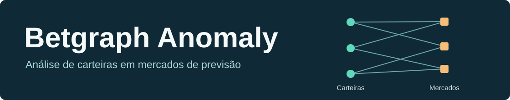

# Betgraph Anomaly

Estudo de priorização de carteiras no Polymarket em **16 de setembro de 2026**. O grafo bipartido liga carteiras aos mercados em que operaram. Uma mesma partida pode originar mercados de vencedor, handicap e totais. A pesquisa investiga quanto a estrutura dessas ligações e os atributos das operações ajudam a colocar comportamentos incomuns no início da fila de revisão.

**Branch principal.** Aqui estão as referências relacional e de atributos, o benchmark do dia completo e a revisão descritiva. As branches [GNN v2](https://github.com/Joao-santos-oliveira/betgraph-anomaly/tree/feat/gnn-v2-anomalias) e [GNN v3](https://github.com/Joao-santos-oliveira/betgraph-anomaly/tree/feat/gnn-v3-anomalias) têm o mesmo roteiro de instalação e seus próprios resultados.

## Reproduzir a partir dos CSVs brutos

Use **um clone Git com histórico**, Linux ou Ubuntu no WSL, GNU Make, Python 3.12 com suporte a venv e acesso à internet para instalar dependências. As revisões históricas usadas pelo executor estão no histórico Git das branches. Em um clone raso, obtenha primeiro o histórico completo. A primeira execução exige somente os **dois arquivos de entrada** abaixo. Os mapeamentos de IDs persistentes acompanham o código.

| CSV em `data/raw/` | Unidade da entrada |
|---|---|
| `betgraph_arestas_16set.csv` | Operações já agregadas por carteira, mercado e outcome, incluindo primeiro e último trade |
| `betgraph_nos_evento_16set.csv` | Mercado identificado por condition_id, pergunta, tags e metadados |

A distribuição prevista é um depósito de dados, como Zenodo. O identificador da edição está nos [hashes SHA-256](resultados/entradas.json). A etapa inicial confere ambos os arquivos. A partir da raiz do clone:

```bash
make ambiente
make validar
make reproduzir
```

Para ler os mesmos arquivos diretamente da pasta de download e escolher onde guardar as execuções:

```bash
make reproduzir BRUTOS="/caminho/para/os/csvs" DESTINO="/caminho/para/execucoes"
```

Cada chamada cria uma pasta exclusiva em `data/execucoes/` por padrão. Dentro dela, o executor recupera localmente o código do experimento, processa os IDs, deriva duração e categoria, exclui mercados recorrentes e suas arestas e agrega as carteiras. Confere os hashes dos **três CSVs tratados regenerados** antes de construir os grafos. Os hashes dos arquivos brutos, a versão e a conclusão ficam em `execucao.json`; a pasta `resultados/` da execução dá acesso às saídas calculadas. Os relatórios auditados usados na comparação permanecem na [pasta resultados do repositório](resultados/).

| Comando | Finalidade |
|---|---|
| `make ambiente` | Criar a venv CPU e instalar as versões de requirements.txt |
| `make validar` | Conferir dependências e executar uma operação PyTorch/PyG |
| `make testes` | Rodar os testes da branch |
| `make reproduzir` | Partir dos CSVs brutos e executar a análise principal desta branch |
| `make historico` | Executar também o controle GNN/MLP de ligações e suas curvas ROC, o piloto viável, a investigação relacional e a validação ampliada com as fichas de casos |

**Saída esperada de `make reproduzir`.** O pipeline primeiro verifica a amostra de 256 carteiras (3.084 mercados, 5.228 linhas e 2.241 pares de contexto) e a ordem integral dos dois rankings. Depois mede o dia completo e confere o resumo e os SHA-256 dos dois rankings completos contra a referência. Para a reprodução em outra máquina, devolver `execucao.json` e o comprovante da amostra acessível em `resultados/` da execução.

## Ficha comparativa das três branches

Valores de recuperação indicam **quantos dos 50 alvos artificiais apareceram nas primeiras 100 posições**, em 5.000 carteiras. A avaliação técnica de escala usa todo o dia tratado. O controle de decoys mede a priorização indesejada de carteiras com coparticipação forte, lados balanceados e horários dispersos.

| Branch e pergunta | Evidência observada | Contribuição e limite |
|---|---|---|
| **main** · Que padrões os métodos simples capturam? | Na comparação pareada da rodada v3, relacional direto recuperou **32/50** com estrutura forte e atributos + IsolationForest recuperou **9/50** com volume ×10. No controle, o relacional destacou **29,5/50 decoys**. | Referências interpretáveis e de baixo custo, sensíveis a tipos diferentes de alteração. Mercados associados ao mesmo evento podem explicar coparticipação. |
| **v2** · O embedding melhora um detector estrutural? | No experimento original, o híbrido contrastivo recuperou **31,67/50**, contra **32/50** do relacional no mesmo cenário de 60%. Seus top 100 compartilharam **94 a 98** carteiras. | Isola o efeito da representação aprendida sobre um score estrutural forte. O ganho consistente exigido pelo protocolo ficou por demonstrar. |
| **v3** · Atributos de aresta, outcome e horário melhoram a priorização? | No cenário combinado S1, a GNN principal ficou em **0/50** nas seis combinações. AP média de **0,0300**, ante **0,0343** do relacional e **0,0454** do manual. | Testa diretamente a informação de aresta, com MLP sem mensagens e controle de decoys. A GNN principal também destacou zero decoys no top 100 global. |

**Comparação nas mesmas intervenções da v3.** A referência v2 foi retreinada nas realizações 30101/30201. Os 31,67 do experimento original da v2 vêm de outras realizações. A tabela abaixo usa apenas as realizações compartilhadas.

| Método | S1 combinado | S2 decoys ↓ | S3 estrutura 60% | S3 volume ×10 |
|---|---:|---:|---:|---:|
| Relacional direto | 0,50 | 29,50 | 32,00 | 0,50 |
| Atributos + IsolationForest | 0 | 2,00 | 0 | 9,00 |
| Híbrido GNN v2 | 0,50 | 29,00 | 31,83 | 0,50 |
| GNN v3, score de pares | 0 | 0 | 0 | 0 |
| GNN v3 + IsolationForest | 0,17 | 0,17 | 0 | 3,83 |

As três seeds de encoder são 42, 73 e 2026. As intervenções artificiais fornecem os rótulos para essa avaliação. A capacidade de identificar fraude em carteiras reais permanece desconhecida. [Tabela original v2](https://github.com/Joao-santos-oliveira/betgraph-anomaly/blob/c0b7390/docs/gnn_v2/resumo.csv) · [Métricas originais v3](https://github.com/Joao-santos-oliveira/betgraph-anomaly/blob/deb24e5/docs/gnn_v3/metricas.csv)

## Onde encontrar os resultados

| Etapa | Arquivo para abrir |
|---|---|
| Filtragem e resultados esperados da amostra | [Assinaturas das entradas](resultados/entradas.json) · [referência dos rankings](resultados/reproducao/referencia.json) |
| Piloto sintético concluído | [Resumo entre seeds](resultados/piloto/resumo_seeds.csv) · [métricas completas](resultados/piloto/metricas.csv) |
| Robustez por intensidade e recorte | [Tabela consolidada](resultados/validacao/resumo.csv) · [figura](resultados/validacao/robustez.png) |
| Escala no dia completo | [Rankings e sobreposição resumidos](resultados/escala/resumo.json) · [custos por estágio](resultados/escala/custos.json) |
| Revisão descritiva individual | [Denominadores por grupo](resultados/revisao/resumo.csv) |

**Piloto sintético.** A primeira tentativa parou antes do treino: uma carteira precisava alcançar dez mercados, mas só oito pares eram permitidos. A correção do gerador preservou a intensidade e as seeds e tornou viável a intervenção em 50 carteiras. Por isso a pasta `resultados/piloto/` apresenta a rodada concluída. O diagnóstico anterior continua disponível no [histórico do piloto v1](https://github.com/Joao-santos-oliveira/betgraph-anomaly/blob/19c9f5a/docs/piloto_validacao/resultado_piloto_v1.md). Essa numeração do gerador é independente das versões das redes.

**Escala.** Dos 560.985 registros brutos de arestas e 22.418 mercados iniciais, a filtragem preservou 358.689 linhas agregadas, 27.039 carteiras e 16.693 mercados. O dia contém 229.072 pares únicos; 137.444 formaram o contexto da divisão com seed 42. Os métodos compartilharam duas carteiras no top 50 e 13 no top 100. Na execução de referência, os cinco estágios do benchmark somaram 56,7 s e o pico de RSS foi 761,6 MiB. Esses tempos cobrem a preparação a partir dos tratados até os rankings, excluindo a filtragem inicial. Tempo e memória dependem da máquina. O [registro da medição original](resultados/escala/fontes_da_medicao.zip) preserva o protocolo e a versão do executor correspondentes aos hashes daquela execução.

**Revisão humana.** Um avaliador descreveu 50 fichas. Houve 25 casos, 15 controles e dez carteiras aleatórias. Das 42 fichas com parceiro, quatro pares recíprocos reduziram o total a 38 relações distintas. Em 13 dos 15 pares caso–controle, o caso compartilhou mais mercados com seu próprio parceiro selecionado. A seleção incorpora coparticipação e permite descrições de padrões, com cegamento parcial. O formulário original encerrado tem SHA-256 `d4a83d5be1623108bf8b613a7a0e3b3203e2ad6c049f323d8c31be81db9a2cf5`. A execução histórica recria as fichas, a seleção e os controles. Os julgamentos humanos são um insumo separado para quem quiser auditar a interpretação.

## Organização e proveniência

| Pasta | Função |
|---|---|
| `src/` | Processamento de CSVs, atributos e construção do grafo |
| `experimentos/` | Detectores e estudos por cenário |
| `scripts/` | Orquestração reproduzível a partir dos brutos |
| `resultados/` | Evidências e referências desta branch |
| `tests/` | Validações da implementação |
| `assets/` | Banner do projeto |
| `data/` | Dados locais e execuções geradas |

Os mapeamentos JSON versionados na raiz conservam os identificadores anteriores à filtragem. O executor reconstrói os experimentos históricos em uma cópia de trabalho isolada, usando a base `1a1d456` para o pipeline principal, `c0b7390` para a v2 e a implementação congelada em `deb24e5` sobre a base original para a v3. Essa cópia permite respeitar os caminhos, protocolos e hashes das rodadas publicadas. Resultados de desenvolvimento referem-se a um dia, e carteiras representam endereços. As informações de maker/taker exigiriam nova extração.
