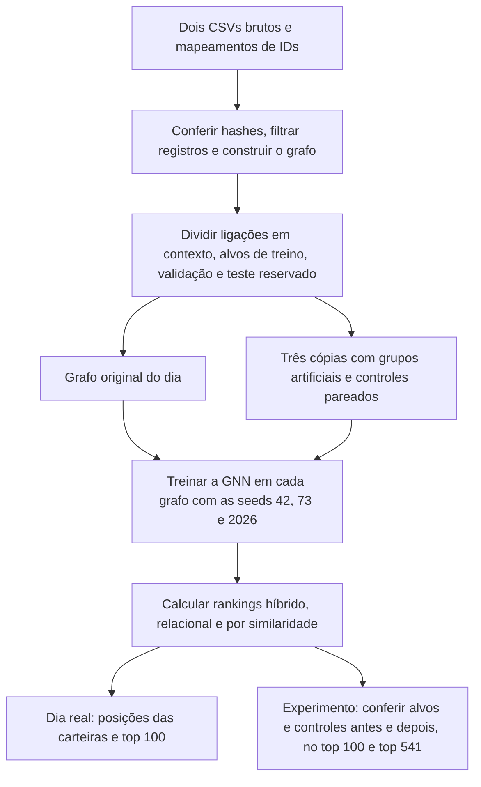

# Betgraph Anomaly

[Estudo](#estudo-principal) · [Estrutura do projeto](#estrutura-do-projeto) · [Resultados](#controle-positivo-e-ablação-do-score) · [Reprodução](#reprodução-do-estudo-principal) · [Comandos Make](#comandos-make) · [Autores](#autores)

## Estudo principal

O Betgraph Anomaly avalia uma **rede neural em grafos heterogêneos (GNN híbrida)** para priorizar carteiras com coparticipação atípica na Polymarket. O recorte de 16/09/2026 contém 27.039 carteiras e 16.693 mercados após a filtragem. No grafo bipartido, cada ligação representa uma carteira que operou em um mercado. A pergunta de pesquisa é quais padrões de atuação em grupo a GNN consegue trazer ao topo da fila de investigação e como a recuperação varia com a intensidade.

### Um dia de atividade real

Um par é uma ligação entre uma carteira e um mercado. Se uma carteira operou cinco vezes no mesmo mercado, isso conta como um único par, mesmo que tenha operado em mais de um resultado. No dia filtrado há **229.072 pares distintos**. A divisão aleatória com seed 42 atribui a cada par uma função.

| Função | Pares | Uso |
|---|---:|---|
| Contexto | 137.444 | Ligações visíveis pelas quais a GNN agrega informações dos vizinhos. |
| Alvos positivos de treino | 45.814 | Ligações reais que a GNN aprende a prever a partir do contexto. |
| Validação | 22.907 | Ligações reservadas para acompanhar o aprendizado e selecionar o checkpoint. |
| Teste | 22.907 | Ligações reservadas para avaliação final. |

No treino, a rede **vê** cerca de 60% das ligações (contexto) e **aprende a prever** outros 20% (alvos de treino). Os dois conjuntos restantes, de aproximadamente 10% cada, servem para validação e teste. Por exemplo, se a carteira A operou em dois mercados, a ligação com o primeiro pode estar visível enquanto a ligação com o segundo serve de alvo.

O ranking publicado ordena todas as 27.039 carteiras usando as 137.444 ligações de contexto. Gerar um ranking com todas as 229.072 ligações seria uma etapa adicional de inferência após o treino e a avaliação, recalculando as representações com os pesos da GNN já fixados.

A carteira 18753 ocupa a primeira posição da GNN nas seeds 42, 73 e 2026. Ela compartilhou 64 mercados com a carteira 18626, ante uma sobreposição esperada de aproximadamente 7,51 pelo modelo relacional. Mercados de uma mesma partida podem explicar parte de uma coincidência. Os dados permitem investigar essa relação, mas atribuir coordenação ou fraude exige evidência independente. [Top 100 da GNN na seed 42](resultados/artigo/top100_dia_real.csv) · [Posições das 27.039 carteiras por método e seed](resultados/artigo/posicoes_dia_real.csv)

### Controle positivo e ablação do score

**As 50 carteiras-alvo de cada realização são casos artificiais usados para medir a capacidade de detecção.** Partimos de uma cópia do grafo real, selecionamos 50 carteiras existentes e modificamos suas ligações com os mercados. Os endereços são reais e o comportamento coordenado foi criado para o experimento. Como sabemos em quais carteiras inserimos o padrão, podemos contar quantas cada método recuperou. Os rótulos de alvo entram apenas nessa avaliação.

Em cada realização, as 50 carteiras formam dez grupos de cinco. Cada grupo passa a compartilhar a mesma lista de 4, 10 ou 20 novos mercados. As trocas preservam o grau de cada carteira e mercado e os pares reservados. Cada alvo tem um controle intacto de mesmo grau. Nos três sorteios, a intensidade de 20 mercados foi atribuída a 15, 15 e 20 carteiras, respectivamente. Por isso, recuperar 50 nessa intensidade significa encontrar todos os casos ao somar três rankings. As outras duas intensidades também somam 50 participações-alvo cada. [Protocolo](experimentos/artigo/protocolo.json)

Os três scores consideram os mesmos pares candidatos com pelo menos dois mercados em comum e agregam as três maiores contribuições por carteira, dividindo a soma por três. O relacional mede a surpresa da sobreposição. A ablação usa apenas a similaridade de cosseno dos embeddings da GNN, reescalada para o intervalo de 0 a 1. A GNN híbrida multiplica os dois termos para cada par. É uma ablação do **score final**. Os embeddings continuam recebendo os atributos estruturais usados no treinamento original.

Cada ranking ordena as 27.039 carteiras de uma realização. Contamos quantos alvos artificiais aparecem nas **primeiras 100 posições** e repetimos a contagem nas **primeiras 541 posições** (cerca de 2% do ranking). A tabela reúne os três sorteios, com 50 participações-alvo por intensidade. Para a GNN, mostramos a média dos totais obtidos com as seeds 42, 73 e 2026.

| Novos mercados em comum | Método | Alvos no top 100 | Alvos no top 541 |
|---:|---|---:|---:|
| 4 | GNN híbrida | 2 | 7 |
| 4 | Apenas similaridade da GNN | 0 | 0 |
| 4 | Relacional direto | 2 | 7 |
| 10 | GNN híbrida | 0 | 24,33 |
| 10 | Apenas similaridade da GNN | 0 | 0 |
| 10 | Relacional direto | 0 | 26 |
| 20 | GNN híbrida | 50 | 50 |
| 20 | Apenas similaridade da GNN | 0 | 0 |
| 20 | Relacional direto | 50 | 50 |

Na linha da GNN híbrida com 4 mercados, **2** alvos entraram nas primeiras 100 posições e **7** entraram nas primeiras 541. Os 7 já incluem os 2 primeiros, portanto 5 ficaram entre as posições 101 e 541. Com 10 mercados, o relacional colocou todos os seus **26** alvos recuperados nessa faixa intermediária. O valor **24,33** da GNN é uma média entre treinamentos.

O top 100 é o corte principal. O top 541 foi introduzido após a primeira análise do dia completo e já constava do protocolo antes de calcular os rankings destes grupos.

### Por que a híbrida recuperou mais alvos que a similaridade isolada?

Imagine dois pares de carteiras com a mesma similaridade aprendida. Um par compartilhou dois mercados quando o esperado era dois. O outro compartilhou vinte quando o esperado também era dois. A ablação atribui a mesma contribuição aos dois pares. A híbrida multiplica a similaridade pela surpresa da sobreposição e, assim, atribui maior peso ao segundo. O cálculo da surpresa considera a atividade das carteiras e a distribuição da popularidade dos mercados.

Com 20 novos mercados em comum, a híbrida colocou **50 de 50 casos no top 100** e a similaridade isolada recuperou **zero até o top 541**. O relacional direto também recuperou os 50. Com 10 mercados, o relacional recuperou 26 no top 541 e a híbrida recuperou 24,33 em média. Portanto, a vantagem observada foi sobre a similaridade isolada. Nestes cenários, a surpresa sozinha já explicou a recuperação dos grupos fortes. A avaliação mede recuperação de padrões inseridos em um dia de dados. A identificação de fraude real exigiria evidência independente. [Resumo com controles](resultados/artigo/resumo.csv) · [Contagens por realização e seed](resultados/artigo/por_realizacao_seed.csv)

## Estrutura do projeto

```text
betgraph-anomaly/
├── data/                              # Pasta local usada na reprodução
│   ├── raw/                           # Coloque aqui os dois CSVs brutos
│   └── execucoes/                     # O Makefile cria uma pasta por execução
├── experimentos/
│   ├── artigo/
│   │   ├── protocolo.json             # Intensidades, sorteios e seeds do estudo
│   │   ├── executar.py                # Executa o estudo a partir dos CSVs
│   │   ├── filtrar.py                 # Filtra os dados e verifica os hashes
│   │   ├── preparar.py                # Cria os grupos artificiais e os controles
│   │   └── ablacao.py                 # Compara os três rankings
│   ├── gnn/
│   │   ├── features.py                # Atributos estruturais das carteiras
│   │   ├── objetivos.py               # Objetivo contrastivo do treinamento
│   │   ├── treino.py                  # Treina a rede e salva os embeddings
│   │   └── detectores.py              # Score híbrido e similaridade isolada
│   └── relacional.py                  # Calcula a surpresa da coparticipação
├── src/                               # Preparo dos CSVs, grafo e arquitetura da GNN
├── resultados/
│   ├── entradas.json                  # Hashes de referência dos dados
│   └── artigo/
│       ├── top100_dia_real.csv        # As 100 primeiras carteiras da GNN na seed 42
│       ├── posicoes_dia_real.csv      # Posições de todas as carteiras
│       ├── resumo.csv                 # Recuperação por método e intensidade
│       └── por_realizacao_seed.csv    # Contagens por sorteio e seed
├── tests/                             # Testes da preparação, dos modelos e da ablação
├── assets/                            # Banner do README
├── mapeamento_*.json                  # IDs de carteiras, mercados e resultados
├── requirements.txt                   # Versões das dependências
└── Makefile                           # Comandos de instalação, teste e reprodução
```

## Reprodução do estudo principal

Em Linux ou WSL, use Python 3.12 e GNU Make. Coloque os dois arquivos brutos `betgraph_arestas_16set.csv` e `betgraph_nos_evento_16set.csv` em `data/raw/`. O executor confere os hashes dos dados, filtra os CSVs, monta o grafo do dia, recria as três intervenções, treina a GNN e calcula os três rankings. As dependências e os dados volumosos permanecem locais. [Hashes das entradas](resultados/entradas.json)

```bash
make ambiente
make validar
make testes
make artigo
```

### Do CSV bruto à tabela de resultados



### Comandos Make

| Comando | Utilidade |
|---|---|
| `make` ou `make ajuda` | Lista os comandos disponíveis. |
| `make ambiente` | Cria a pasta `.venv` e instala as versões das dependências fixadas em `requirements.txt`. |
| `make validar` | Verifica as dependências e executa uma operação em CPU com propagação de gradientes no PyTorch Geometric. |
| `make testes` | Executa os testes automatizados de preparação, divisão do grafo, treino e cálculo dos scores. |
| `make artigo` | Executa o experimento completo a partir dos dois CSVs brutos e grava os resultados em uma nova pasta. |
| `make reproduzir` | Atalho para `make artigo`. Basta executar um dos dois. |

Use `BRUTOS=/caminho/para/csvs` e `DESTINO=/caminho/para/execucoes` para escolher as pastas. O padrão é um processo de treino por vez. `make artigo PROCESSOS=3` permite treinar as três seeds em paralelo quando há memória disponível. Cada chamada cria uma pasta exclusiva e imprime a localização dos CSVs de resultados. O código do artigo fica em [experimentos/artigo](experimentos/artigo) e o modelo em [experimentos/gnn](experimentos/gnn).

Para reavaliar embeddings salvos de uma execução, use:

```bash
.venv/bin/python -m experimentos.artigo.ablacao PASTA_DA_EXECUCAO PASTA_DE_SAIDA
```

### Onde encontrar cada resultado

| Pergunta | Arquivo publicado |
|---|---|
| Quais carteiras lideraram o ranking híbrido na seed 42? | [Top 100 do dia real](resultados/artigo/top100_dia_real.csv) |
| Uma carteira mudou de posição entre métodos ou seeds? | [Posições de todas as carteiras](resultados/artigo/posicoes_dia_real.csv) |
| Quantos alvos e controles apareceram em cada corte, antes e depois da intervenção? | [Resumo por intensidade](resultados/artigo/resumo.csv) |
| Quanto o resultado variou de um sorteio ou treinamento para outro? | [Resultados por realização e seed](resultados/artigo/por_realizacao_seed.csv) |

## O que há nas outras branches

| Branch | Conteúdo |
|---|---|
| [feat/gnn-v2-anomalias](https://github.com/Joao-santos-oliveira/betgraph-anomaly/tree/feat/gnn-v2-anomalias) | Desenvolvimento histórico do modelo principal, com treino contrastivo, score híbrido e Isolation Forest sobre embeddings. |
| [feat/gnn-v3-anomalias](https://github.com/Joao-santos-oliveira/betgraph-anomaly/tree/feat/gnn-v3-anomalias) | Experimento com atributos de aresta, incluindo lado escolhido, horário e valor, além dos controles sintéticos. |
| [feat/evidencias-artigo](https://github.com/Joao-santos-oliveira/betgraph-anomaly/tree/feat/evidencias-artigo) | Benchmark anterior na coorte de 5.000 carteiras, com tabelas comparativas, figuras, subgrafos e comprovantes de reprodução. |

A comparação anterior de escalas e o resumo da revisão descritiva podem ser consultadas no [histórico da main](https://github.com/Joao-santos-oliveira/betgraph-anomaly/tree/e976ca3/resultados).

## Autores

<table>
  <tr>
    <td align="center"><a href="https://github.com/Joao-santos-oliveira"><br><strong>João Gabriel Santos</strong><br>@Joao-santos-oliveira</a></td>
    <td align="center"><a href="https://github.com/alisson-h"><br><strong>Alisson Henrique</strong><br>@alisson-h</a></td>
  </tr>
</table>
