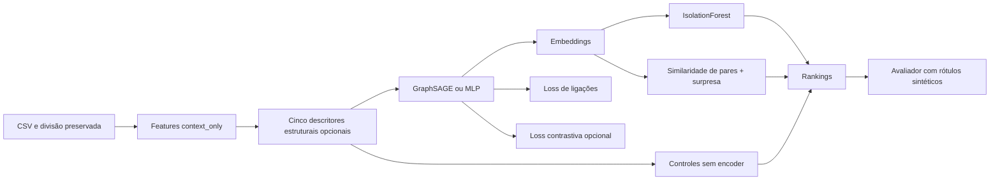

# GNN v2 — implementação experimental

Branch `feat/gnn-v2-anomalias`, criada a partir de `1a1d456`. A main e os modelos anteriores são preservados. Consulte `protocolo.md` para as decisões anteriores à avaliação e `resultado.md` para os resultados medidos, quando concluídos.

## Módulos

- `experimentos/gnn_v2/features.py`: acrescenta cinco descritores de coparticipação, sem IDs ou rótulos. Transformações log1p e StandardScaler com estado salvo.
- `objetivos.py`: corrupções de features dentro de cada tipo de nó e discriminação auto-supervisionada. Não classifica as carteiras injetadas como treino supervisionado.
- `treino.py`: usa GraphSAGE/MLP originais; combina loss de ligação com objetivo opcional; salva checkpoint, embeddings, histórico e parâmetros. Seleção por validação de ligações; teste fechado.
- `detectores.py`: ordenação determinística e ranking de pares com surpresa multiplicada por similaridade. O híbrido usa explicitamente o detector relacional: não é score puro da GNN.
- `executar.py`: prepara seis novas intervenções, executa a matriz de comparações e avalia somente após produzir os rankings. Não substitui realizações desfavoráveis.



As seis variantes isolam encoder e uso de features/contraste. GNN/MLP não têm o mesmo número de parâmetros; capacidade e custo são reportados. Mantemos hidden/embedding/orçamento idênticos; o controle MLP não elimina todas as diferenças de capacidade.

## Comandos

A partir da raiz, com os dados locais da validação ampliada disponíveis:

```bash
.venv/bin/python -B -m unittest discover -s tests -v
.venv/bin/python -B -m experimentos.gnn_v2.executar
# Retomada somente após interrupção entre trabalhos completos:
.venv/bin/python -B -m experimentos.gnn_v2.executar --resume
```

O destino padrão é `data/processed/gnn_v2_v1`. Uma execução nova recusa pasta existente. A retomada confere hashes e não sobrescreve treino parcial: se um processo morrer durante um treino, preserve sua pasta, investigue a causa e só então mova o trabalho parcial para uma pasta de arquivo antes de retomar. Não use retomada para alterar hiperparâmetros.

`--output` permite outra pasta para reprodução; dados/artefatos não são enviados ao Git. O congelamento novo usa caminhos relativos ao repositório, para permitir conferir uma cópia em outra máquina. O input `data/processed/validacao_ampliada_v1/novo/` deve ser compartilhado separadamente ou regenerado pelo experimento anterior. Reproduções dependem também das versões de `requirements.txt`.

## Como interpretar

- AP/AUC de validação do treino são métricas de ligação, não de anomalia.
- Precisão@100 sintética é o número de alvos designados entre os100primeiros, dividido por100; recall@100 divide por50. Não são taxas conhecidas de fraude real.
- Uma melhora frente à GNN base não basta: comparar com MLP de mesmas features, IF nas features enriquecidas e surpresa direta.
- O próprio score relacional entra nas features enriquecidas. Ganho pode vir dessa informação explícita, não da aprendizagem relacional.
- O híbrido pode apenas reproduzir a surpresa se os embeddings forem muito semelhantes. Comparar valores e rankings, não só a presença de uma GNN no pipeline.
- Duas realizações não permitem uma conclusão populacional robusta. Todos os cenários compartilham um dia e a mesma amostra base. O conjunto completo e novos dias ainda exigem avaliação própria.

## Resultado desta rodada

A avaliação e a auditoria terminaram: 126 treinos, 32 testes e reprodução exata do baseline GNN da main na seed 42. O híbrido com GNN não superou o relacional direto; manter a v2 como ablação experimental, sem promovê-la a detector principal. Veja [comparação completa](resultado.md).

O executor alternativo `docs/gnn_v2/executar_paralelo.py` distribui cenários em três processos com duas threads por treino. Ele preserva os modelos, dados e hiperparâmetros congelados, arquiva trabalhos interrompidos e registra o agendamento. Requer que a preparação inicial exista e que nenhum outro executor esteja gravando nas mesmas pastas. A auditoria deve ser executada após o término.
