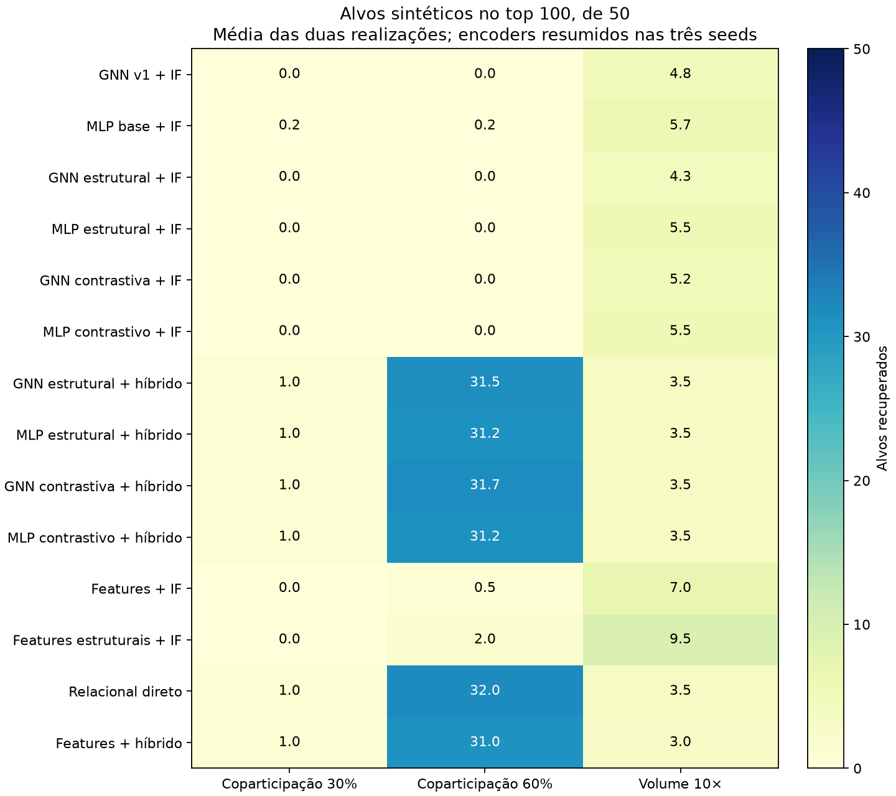
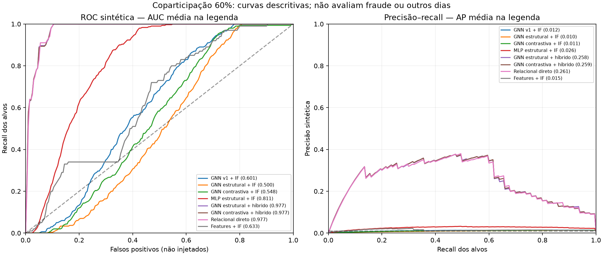

# GNN v2 — comparação experimental

Branch `feat/gnn-v2-anomalias`, base `1a1d456`. A main não foi alterada. Avaliação de alvos artificiais em novas realizações, com protocolo e código congelados antes de consultar métricas. Não é detecção confirmada de fraude.

## O que foi implementado

Cinco features estruturais acrescidas às features de contexto; encoders GraphSAGE e MLP equivalentes em entradas; objetivo contrastivo opcional, além da previsão de ligações; e detector híbrido de pares. Os módulos estão explicados em [README](README.md). A loss contrastiva é uma adaptação inspirada em [Deep Graph Infomax](https://arxiv.org/abs/1809.10341), não uma reprodução exata do artigo.

## Resultados

Número médio de alvos entre os 100 primeiros, de 50 injetados. Primeiro resumimos as seeds 42, 73, 2026 dentro de cada realização e depois as duas realizações 20101/20201. Baselines sem encoder têm uma avaliação por realização. Os valores fracionários são médias, não quantidades de carteiras em um ranking específico.

| Método | Copart. 30% | Copart. 60% | Volume 10× | AP em copart. 60% |
| --- | --- | --- | --- | --- |
| GNN v1 + IF | 0.00 | 0.00 | 4.83 | 0.0118 |
| MLP base + IF | 0.17 | 0.17 | 5.67 | 0.0251 |
| GNN estrutural + IF | 0.00 | 0.00 | 4.33 | 0.0096 |
| MLP estrutural + IF | 0.00 | 0.00 | 5.50 | 0.0261 |
| GNN contrastiva + IF | 0.00 | 0.00 | 5.17 | 0.0106 |
| MLP contrastivo + IF | 0.00 | 0.00 | 5.50 | 0.0261 |
| GNN estrutural + híbrido | 1.00 | 31.50 | 3.50 | 0.2580 |
| MLP estrutural + híbrido | 1.00 | 31.17 | 3.50 | 0.2552 |
| GNN contrastiva + híbrido | 1.00 | 31.67 | 3.50 | 0.2586 |
| MLP contrastivo + híbrido | 1.00 | 31.17 | 3.50 | 0.2552 |
| Features + IF | 0.00 | 0.50 | 7.00 | 0.0149 |
| Features estruturais + IF | 0.00 | 2.00 | 9.50 | 0.0404 |
| Relacional direto | 1.00 | 32.00 | 3.50 | 0.2614 |
| Features + híbrido | 1.00 | 31.00 | 3.00 | 0.2546 |

Precisão sintética@100 = recuperados/100; recall@100 = recuperados/50. Por exemplo, 30 alvos significam 30% de precisão sintética e 60% de recall. Os não injetados não são normais confirmados. As métricas completas por seed, original/injetado, universo elegível e sem doadoras estão em `metricas.csv`; mudanças antes/depois em `mudanca_antes_depois.csv`.

As curvas são descritivas, não intervalos de confiança. As seis curvas dos encoders compartilham duas intervenções e um recorte. AP resume o ranking com prevalência de 1%; AUC alta, isoladamente, não garante recuperação no topo.

## Decisão experimental

Nenhuma variante GNN satisfez simultaneamente o critério de superioridade em top100 e AP nas duas realizações frente à GNN base, ao MLP equivalente e ao relacional direto.

Recomendação: manter os módulos e resultados da v2 como ablação experimental, mas não substituir o detector relacional direto por uma GNN nesta configuração. O custo adicional não demonstrou ganho consistente. Para o pipeline principal, conservar os canais relacional e de atributos, sem tratá-los como detectores de fraude confirmada.

O híbrido contrastivo compartilhou 94–98 carteiras do top100 com o detector direto. A mediana da razão entre seus scores nesses casos variou de 0.9894 a 0.9933. Isso mostra pequena modulação do score já existente; não uma vantagem demonstrada da representação aprendida.

O critério exige consistência entre realizações, não escolher a melhor seed. Ver `por_realizacao.csv`. Esta conclusão não equivale a descartar toda GNN. As features estruturais incluem o score relacional conhecido; melhora pode vir da informação manual adicionada. O híbrido também multiplica esse score pela similaridade, portanto sua eficácia não pode ser atribuída automaticamente à rede. Comparar especialmente com MLP e features+híbrido.

## Execução, controles e limites

Foram concluídos 126 treinos, com as seis variantes e três seeds nos sete grafos. O total somado dos tempos de treino foi 60.39 minutos; isso não é duração de parede, pois os cenários foram distribuídos em três processos com duas threads cada. O agendamento preservou os trabalhos completos e arquivou um treino interrompido, sem alterar hiperparâmetros ou abrir métricas. Registro em `agendamento.json`. Parâmetros e custos por variante em `custos.csv`.

- Entrada: segunda amostra de 5.000 carteiras do mesmo dia, já utilizada na validação ampliada. As intervenções são novas; o dia e as carteiras de base não são novos dados independentes.
- Checkpoints selecionados somente por loss de validação de ligações; nenhum rótulo de injeção entrou nas features,loss ou escolha de época. Essa escolha pode favorecer a tarefa de ligações e limitar o objetivo contrastivo; foi fixada previamente.
- O contraste embaralha features, não simula necessariamente fraude ou o padrão coletivo de interesse. Alterações de arestas/tempo e outros objetivos exigem novos experimentos.
- MLP e GNN têm capacidades diferentes apesar de hidden/embedding iguais; contagens de parâmetros são explícitas. Contraste acrescenta discriminadores e custo.
- O score de pares usa cauda Poisson aproximada, não p-valor calibrado. Coparticipação legítima, modalidade e mercados relacionados continuam sendo explicações alternativas.
- Nem o conjunto completo, nem outros dias, nem o teste final de ligações foram avaliados nesta rodada. Dois cenários de atributo/estrutura não esgotam o conceito de anomalia.
- Os 32 testes passaram; auditoria dos checkpoints e métricas em `auditoria.json`. Dados e modelos permanecem fora do Git; não foi feito merge para main.

## Próximos passos até o fechamento do projeto

1. Revisar esta comparação e decidir se a v2 fica como candidato principal ou apenas como ablação documentada. Não apagar resultados negativos nem selecionar uma seed favorável.
2. Preencher independentemente os dois formulários dos casos reais já preparados; registrar explicações alternativas e desacordos. A avaliação humana está pendente.
3. Agrupar mercados relacionados e testar controles por modalidade/evento em novo protocolo; obter outros dias com a mesma extração e auditar disponibilidade temporal dos metadados.
4. Fazer benchmark de RAM/tempo no conjunto completo do dia e repetir os modelos selecionados com novos cenários reservados, sem ajustar aos resultados aqui usados.
5. Congelar escolhas finais e avaliar o teste reservado de ligações separadamente. Não confundir essa métrica com detecção de fraude.
6. Consolidar comandos/Makefile e reprodução no computador do colega, proveniência dos dados e arquivos necessários fora do Git.
7. Escrever metodologia, comparações, custos, resultados negativos e limitações; revisar com orientador e adequar ao congresso. Nenhum resultado garante aprovação.

## Reprodução

Ver [README](README.md), [protocolo](protocolo.md). Consolidação: `.venv/bin/python -B docs/gnn_v2/consolidar.py`. Auditoria: `.venv/bin/python -B docs/gnn_v2/auditar.py`. Leitura de rankings com `float_precision="round_trip"` evita empates artificiais. Artefatos completos em `data/processed/gnn_v2_v1/`.
