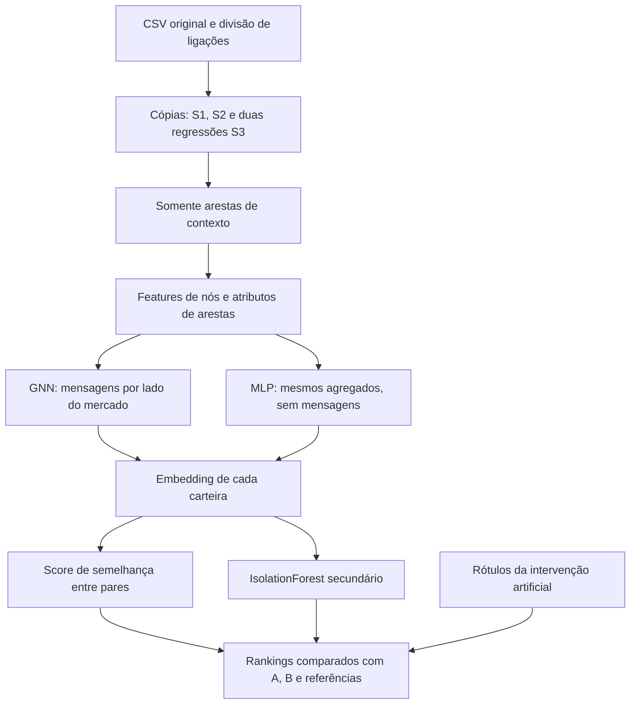

# Como ler a tentativa GNN v3

Comece por `resultado.md` para a conclusão e por `protocolo.md` para as regras definidas antes dos resultados. Os dados continuam sendo uma amostra de5.000carteiras de um único dia. A experiência não confirma fraude.

## Caminho dos dados

O modelo nunca recebe K. O termo auxiliar cria seus próprios exemplos: arestas observadas versus atributos permutados e lados invertidos. Aprender a distinguir essas duas condições não significa, por si só, aprender a priorizar as intervenções; o ranking precisa ser avaliado separadamente.

## Arquivos do código

- `experimentos/gnn_v3/trocas.py`: cópia do gerador anterior, com filtro de mercados com dois lados observados. Preserva graus ao trocar blocos carteira–mercado.
- `dados.py`: aplica intervenções em cópias, verifica integridade, cria catálogo de lados, scalers, entradas e grafo com atributos.
- `modelos.py`: implementa GNN e MLP, treinamento, corrupção auxiliar e seleção do checkpoint por loss sem rótulos artificiais.
- `scores.py`: calcula A/B, canais individuais, score aprendido, rankings e métricas nos três universos.
- `executar.py`: congela hashes, prepara cenários, agenda os treinos, avalia a regra e reexecuta scores na auditoria.
- `tests/test_gnn_v3.py`: verifica invariantes com fixtures artificiais, sem usar resultados das realizações para ajustar o método.

## Como interpretar os cenários

S1: queremos recuperar os50alvos. S2: queremos **não** priorizar os50decoys; recuperar mais é pior nesse controle. S3: verifica se a tentativa perde desempenho em situações já estudadas. Não some S1 e S2 num único placar.

A=surpresa relacional; B=combinação manual de quatro canais; C=GNN nova; D=MLP; E_v2=GNN anterior híbrida; E_features=features+IsolationForest. C_IF/D_IF são alternativas secundárias previamente definidas, não escolhas feitas depois dos resultados.

Os artefatos grandes ficam em `data/processed/gnn_v3_v1/`, ignorado pelo Git. Esta pasta de documentação guarda os resultados pequenos e a trilha de auditoria. Não foram alterados `src/`, arquivos anteriores, main ou histórico de commits.
