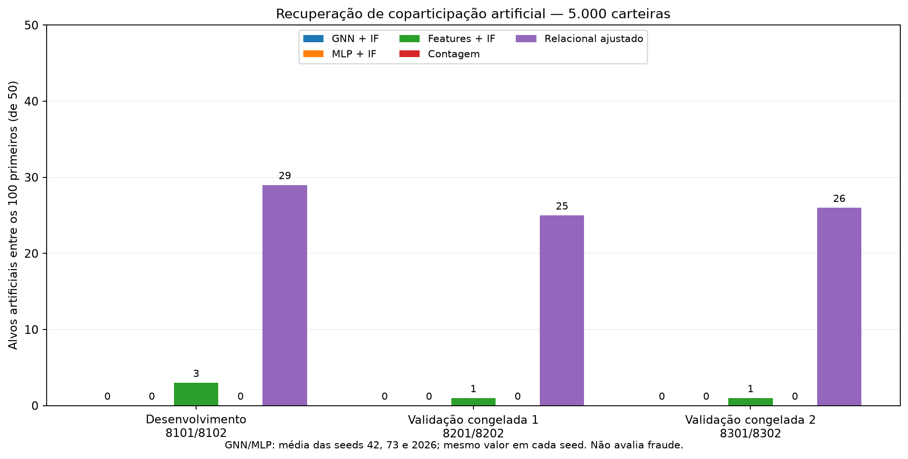

# Investigação: por que os alvos não aparecem no topo?

Execução em 25/10/2026 (UTC: 26/10). Esta investigação parte do piloto v2, sem apagar seus resultados. Trata-se de recuperação de intervenções artificiais, não de classificação de fraude. A amostra continua com 5.000 carteiras; o teste final de ligações não foi avaliado.

## Diagnóstico e evidências

1. **O objetivo de treino não é o objetivo de detecção.** A GNN aprende a distinguir ligações observadas de pares negativos. O piloto tinha ROC-AUC de validação de ligações próximo de 0,936, mas nenhuma das três seeds recuperava alvos no top 100. Uma carteira que participa repetidamente dos mesmos mercados de outras carteiras pode ser previsível para esse objetivo e não parecer isolada no espaço de embeddings.
2. **O topo favorecia atividade muito superior à dos alvos.** No cenário injetado, a média entre seeds da mediana do grau no top 100 da GNN foi 58,33, contra mediana 7 nos alvos. A correlação de Spearman score–grau foi 0,570 e score–volume 0,554. São associações, não prova de causa única. O grau foi preservado pela injeção; as features individuais não foram todas preservadas.
3. **O encoder reage à alteração.** Com os pesos originais congelados e mudando somente as arestas, a distância média dos embeddings dos alvos foi 0,761–0,849, contra 0,0199–0,0209 nas demais carteiras excluindo doadoras. Mudando somente as features, também há efeito. São distâncias descritivas dentro de cada seed: não demonstram separabilidade nem recuperação por um detector.
4. **Duas alternativas locais não resolveram no desenvolvimento.** LOF com 20 vizinhos e erro médio de reconstrução das ligações do contexto recuperaram zero alvos no top 100. LOF emitiu aviso de duplicatas nos embeddings; esse resultado não descarta variantes de densidade. Reconstrução foi medida nas arestas do próprio contexto, portanto é diagnóstico in-sample.
5. **A agregação por média tem uma limitação específica.** Um teste construído, com features constantes e grau 2, produz os mesmos embeddings para pequenos grupos bipartidos e para um ciclo longo, embora os compartilhamentos repetidos sejam diferentes. Isso não prova que toda GNN falha no dataset real. É consistente com limitações de expressividade discutidas por [Xu et al.](https://arxiv.org/abs/1810.00826); a arquitetura base usa agregação do tipo [GraphSAGE](https://arxiv.org/abs/1706.02216).

**Conclusão:** não foi encontrado um erro de ordenação ou um filtro que excluísse os alvos. As evidências apontam para inadequação do pipeline atual ao padrão coletivo escolhido. Não atribuímos a falha a uma causa única nem a todas as GNNs.

## Correção implementada no pipeline experimental

Adicionamos um detector relacional explícito e interpretável, mantendo GNN + IF, MLP + IF e features + IF como comparadores. Não alteramos a arquitetura da GNN nem alegamos que ela passou a recuperar os alvos.

Para cada par de carteiras, contamos os mercados compartilhados. Com pelo menos dois mercados em comum, calculamos uma surpresa aproximada em relação aos graus das carteiras e à distribuição de graus dos mercados. O score é a soma das três maiores surpresas dividida por três; parceiros ausentes contribuem zero.

Definição: `lambda_uv = d_u * d_v * sum_m(d_m*(d_m-1)) / (E*(E-1))`; surpresa `-log10 P[Poisson(lambda_uv) >= compartilhamentos]`, limitada numericamente a 300. Esta é uma aproximação heurística para ordenar casos, **não um p-valor calibrado**. O ajuste usa a distribuição global de graus de mercado; não é uma normalização exata pela identidade/popularidade de cada mercado compartilhado.

O algoritmo usa apenas arestas de contexto; não recebe rótulos, mercados-alvo ou pares reservados. Calcula produtos esparsos em blocos, evitando materializar uma matriz densa completa de carteiras. O ranking inclui grau, parceiro de maior surpresa, número de mercados compartilhados e sobreposição esperada aproximada. Esse parceiro explica a maior contribuição, não necessariamente todo o score de três parceiros. A contagem sem ajuste é um controle adicional.

## Resultados

| Realização | Método | AP | ROC-AUC | Alvos top 50 | Alvos top 100 |
| --- | --- | --- | --- | --- | --- |
| 8201_8202 | contagem | 0.0620 | 0.9257 | 0 | 0 |
| 8201_8202 | features | 0.0147 | 0.6206 | 0 | 1 |
| 8201_8202 | gnn | 0.0120 | 0.6142 | 0 | 0 |
| 8201_8202 | mlp | 0.0223 | 0.7850 | 0 | 0 |
| 8201_8202 | relacional | 0.2082 | 0.9726 | 15 | 25 |
| 8301_8302 | contagem | 0.0673 | 0.9312 | 0 | 0 |
| 8301_8302 | features | 0.0141 | 0.5863 | 0 | 1 |
| 8301_8302 | gnn | 0.0128 | 0.6404 | 0 | 0 |
| 8301_8302 | mlp | 0.0221 | 0.7854 | 0 | 0 |
| 8301_8302 | relacional | 0.2462 | 0.9810 | 17 | 26 |

GNN/MLP: média das seeds 42, 73 e 2026; todas recuperaram zero alvos no top 50/100. Features/contagem/relacional: uma avaliação determinística por realização (IF fixado em 42).

No desenvolvimento, o novo detector recuperou 29/50 no top 100 (AP 0,2182). Nas realizações congeladas, recuperou **25/50 e 26/50**, ou recall de **50% e 52%**; a precisão no top 100 foi 25% e 26%. Antes da injeção, esses mesmos grupos tinham 3 e 5 integrantes no top 100. A recuperação não é completa: 25 e 24 alvos ainda ficaram fora desse corte.

No universo elegível, a AP do detector relacional passou de 0,0861 para 0,5216 e de 0,0842 para 0,5841. Isso reduz a preocupação de o ganho resultar somente da separação de carteiras isoladas, mas não elimina os limites do cenário sintético. Todas as métricas, inclusive original/injetado e universo sem doadoras, estão em `metricas_validacao.csv`.

Foram executados 24 novos treinos e 28 rankings dos comparadores, além de quatro rankings relacionais de validação. As rodadas completas levaram 108,69 s e 106,56 s nesta máquina, excluindo os diagnósticos de desenvolvimento. Estes tempos não estimam o conjunto completo.



## Validação e rastreabilidade

- Desenvolvimento: seleção/trocas 8101/8102. As seeds 42, 73 e 2026 variam os encoders, não as intervenções. O detector estrutural é determinístico.
- Código e parâmetros congelados em `validacao_congelada.json` antes de gerar 8201/8202 e 8301/8302. Nenhuma seed foi substituída; confira `status_validacao.json`.
- Novas realizações usam o mesmo dia, as mesmas carteiras de base e a mesma família de injeção. Não são amostras independentes de outra população nem validação temporal. A seleção do método foi guiada pelo desenvolvimento e pela definição do padrão artificial.
- Rótulos só entram na avaliação. Carteiras não injetadas são referências não rotuladas, não normais confirmadas. Doadoras também mudam; métricas adicionais excluem doadoras e restringem ao universo elegível.
- Os novos treinos mantêm a mesma configuração do piloto. Arquivos protegidos, partições e atributos preservados são verificados pelo executor; mudanças nos negativos são registradas em `execucao.json`. Não usamos os rótulos sintéticos para escolher épocas.
- 25 testes passaram, incluindo contagem manual/cauda, isolados, duplicatas, invariância a reindexação e tamanho de bloco e o exemplo da limitação da média.

## O que muda na análise experimental

A pergunta continua sendo se informação relacional acrescenta evidência útil em relação às features individuais. Passamos a comparar **representação aprendida por previsão de ligações** com **score explícito de coparticipação**, além dos controles individuais. Um resultado negativo da GNN faz parte da contribuição experimental; não é necessário esconder esse resultado ou prometer superioridade da rede.

Esta etapa fecha o diagnóstico do piloto e a avaliação da alternativa nas realizações disponíveis. Ainda não fecha a qualidade das anomalias reais. Próximas etapas:

1. Inspecionar casos reais e controles pareados por atividade, incluindo casos exclusivos da GNN e do novo detector. Congelar seleção e formulário antes da revisão, com dois avaliadores se possível. Coparticipação pode refletir mercados relacionados ou estratégias legítimas.
2. Registrar um novo protocolo antes de variar intensidade/proporção e padrões artificiais. As duas realizações agora abertas não podem continuar sendo chamadas de reservadas em futuras escolhas. Incluir nulos com graus preservados e avaliar a influência da popularidade específica dos mercados; não reutilizar as realizações para ajustar cortes.
3. Executar um benchmark de memória e tempo no conjunto completo do dia, depois repetir a comparação com novas realizações. A projeção carteira–carteira pode crescer muito mesmo com blocos; não extrapolar tempo linearmente a partir da amostra.
4. Se houver justificativa para uma segunda GNN, testar objetivo voltado a grupos/coparticipação ou descritores estruturais com ablações. Isso é trabalho futuro, não correção já validada nem garantia de ganho. A GNN atual permanece um baseline reproduzível.
5. Após congelar decisões, abrir o teste final de ligações separadamente e consolidar comandos/Makefile e artigo. Esse teste mede ligações, não fraude.

## Reprodução e arquivos

Na raiz do projeto:

```bash
.venv/bin/python -B -m unittest discover -s tests -v
.venv/bin/python -B -m experimentos.investigacao_anomalias.ranking_relacional \
  --input data/processed/sintetico/piloto_v2_8101_8102/original/resultados/divisao.pt \
  --output data/processed/ranking_relacional_novo
```

O destino deve ser novo. O ranking original desta execução está em `data/processed/investigacao_anomalias_v1/ranking_original/`. Os diagnósticos estão em `desenvolvimento/`, e as comparações adicionais em `validacao/`, sob a mesma pasta. Os treinos completos permanecem em `data/processed/sintetico/piloto_v2_<selecao>_<trocas>/`.

`python -B -m experimentos.investigacao_anomalias.validar` reproduz a rodada congelada a partir do piloto de desenvolvimento, em uma cópia do projeto sem as pastas de saída desta validação. Por segurança, recusa sobrescrever resultados. Os hashes do congelamento precisam corresponder aos arquivos; não regenere o congelamento para ocultar mudanças.

Dados e checkpoints não entram no Git. Este diretório inclui métricas e figura pequenas para revisão; compartilhar apenas o repositório não transfere os dados. Nenhum commit foi feito nesta investigação.
