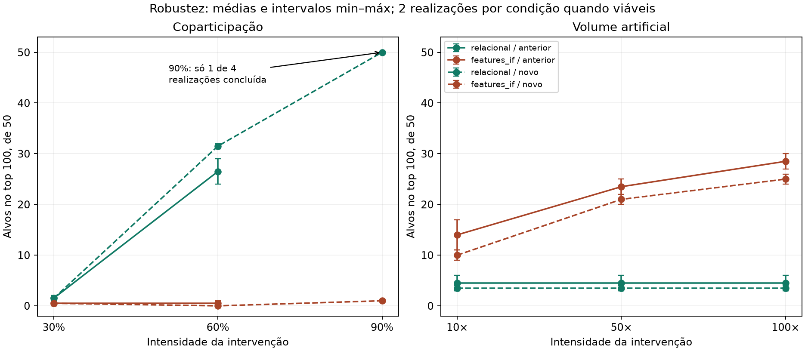

# Validação ampliada — resultados de 26/10/2026

Executamos a parte computacional e uma inspeção descritiva dos casos reais. **Não concluímos validação de fraude nem revisão humana independente.** Apenas um dia de dados está disponível. O novo recorte usa outras 5.000 carteiras do mesmo dia, sem sobreposição de carteiras com a amostra anterior; mercados podem ser compartilhados.

## Resultado principal

- **Coparticipação a 60%:** o detector relacional recuperou 24–29 alvos no top 100 na amostra anterior e 31–32 na nova, de 50 alvos. Features+IF recuperou 0–1 e 0, respectivamente. O ganho se repetiu em novas seleções e carteiras.
- **Coparticipação a 30%:** o detector relacional recuperou apenas 1–2 alvos por realização em ambos os recortes. A sensibilidade depende da força do padrão; não é um detector geral de qualquer coordenação.
- **Coparticipação a 90%:**3 das 4 tentativas não completaram a intervenção após 1 milhão de propostas; uma concluiu e recuperou 50 alvos no top 100. Não usar essa execução isolada como resultado representativo nem chamar as demais de recuperação zero. O gerador não demonstrou impossibilidade matemática: apenas não concluiu sob as regras e orçamento registrados.
- **Volume:** IF em features recuperou 11–17 alvos no recorte anterior e 9–11 no novo com fator 10; com fator 100,27–30 e 24–26. O score relacional permaneceu exatamente igual ao anterior à injeção porque as conexões não mudaram; seus 3–6 alvos no top 100 já estavam lá. Isso não é detecção da mudança de volume.

Foram planejados 24 cenários:21 concluídos e 3 não concluídos, sem troca de seeds. São dois tipos de intervenção (estrutura e atributo), três intensidades e dois recortes. As duas seeds de injeção são 9201 e 9301; IF permanece 42. Esta rodada **não retreinou GNN/MLP**; avalia o detector relacional adicionado contra features+IF. Os resultados anteriores desfavoráveis à GNN permanecem válidos para aquele protocolo.



## Métricas completas

| Recorte | Padrão | Intensidade | Método | n concluídos | AP média | AUC média | Alvos top100 (min–máx) |
| --- | --- | --- | --- | --- | --- | --- | --- |
| anterior | coparticipacao | 0.3 | features_if | 2 | 0.0159 | 0.6248 | 0–1 |
| anterior | coparticipacao | 0.3 | relacional | 2 | 0.0346 | 0.8652 | 1–2 |
| anterior | coparticipacao | 0.6 | features_if | 2 | 0.0158 | 0.6334 | 0–1 |
| anterior | coparticipacao | 0.6 | relacional | 2 | 0.2284 | 0.9740 | 24–29 |
| anterior | volume | 10 | features_if | 2 | 0.1088 | 0.8463 | 11–17 |
| anterior | volume | 10 | relacional | 2 | 0.0315 | 0.8223 | 3–6 |
| anterior | volume | 50 | features_if | 2 | 0.2576 | 0.9263 | 22–25 |
| anterior | volume | 50 | relacional | 2 | 0.0315 | 0.8223 | 3–6 |
| anterior | volume | 100 | features_if | 2 | 0.3365 | 0.9538 | 27–30 |
| anterior | volume | 100 | relacional | 2 | 0.0315 | 0.8223 | 3–6 |
| novo | coparticipacao | 0.3 | features_if | 2 | 0.0182 | 0.6746 | 0–1 |
| novo | coparticipacao | 0.3 | relacional | 2 | 0.0414 | 0.8845 | 1–2 |
| novo | coparticipacao | 0.6 | features_if | 2 | 0.0133 | 0.6056 | 0–0 |
| novo | coparticipacao | 0.6 | relacional | 2 | 0.2524 | 0.9814 | 31–32 |
| novo | coparticipacao | 0.9 | features_if | 1 | 0.0126 | 0.5830 | 1–1 |
| novo | coparticipacao | 0.9 | relacional | 1 | 0.5369 | 0.9962 | 50–50 |
| novo | volume | 10 | features_if | 2 | 0.0797 | 0.8215 | 9–11 |
| novo | volume | 10 | relacional | 2 | 0.0296 | 0.7920 | 3–4 |
| novo | volume | 50 | features_if | 2 | 0.1968 | 0.9271 | 20–22 |
| novo | volume | 50 | relacional | 2 | 0.0296 | 0.7920 | 3–4 |
| novo | volume | 100 | features_if | 2 | 0.2730 | 0.9495 | 24–26 |
| novo | volume | 100 | relacional | 2 | 0.0296 | 0.7920 | 3–4 |

A AP e AUC referem-se à recuperação de alvos artificiais, não fraude. Todas as avaliações original/injetado, incluindo universos elegível e sem doadoras, estão em `metricas.csv`. Os alvos elegíveis de coparticipação podem mudar entre intensidades; as curvas não são um efeito causal nos mesmos indivíduos. Para volume, os mesmos alvos são mantidos entre fatores por seed/recorte. Não há intervalo de confiança populacional: barras são mínimo/máximo de duas realizações, ou nenhuma amplitude com apenas uma.

## Controles com conexões aleatorizadas

Foram feitas quatro aleatorizações, duas por recorte, preservando graus e evitando positivos reservados. O percentil 99 do score caiu de 8,65 para 3,43–3,52 na amostra anterior e de 8,82 para 3,68–3,76 na nova. Só 6–9 e 4–5 carteiras, respectivamente, permaneceram nos mesmos top 100. Esses controles mostram dependência da organização das conexões além dos graus, mas não provam anomalia: a aleatorização também destrói especialização legítima em modalidades e mercados relacionados. Não presumimos amostragem uniforme dos grafos possíveis nem calculamos p-valores/FPR a partir de duas aleatorizações.

## Casos reais

A seleção congelada gerou 25 casos da união top 10 dos quatro métodos,15 controles semelhantes em grau/volume e 10 aleatórios. Dez casos não tiveram controle dentro do limite definido. As 50 fichas trazem dados e subgrafos limitados, e há dois formulários vazios para revisão independente. Ver [inspeção preliminar](inspecao_preliminar.md).

Exemplo:13537 e seu controle 13826 têm 71 mercados cada e volume próximo (US$1689,83 vs 1851,34), mas 39 vs 7 mercados em comum com seus respectivos parceiros de maior surpresa. Alguns casos destacam e-sports ou tênis, incluindo mercados relacionados à mesma partida. Isso oferece uma explicação legítima plausível e mostra a necessidade de controlar modalidade/evento antes de alegar coordenação. A diferença também é parcialmente esperada pela seleção por score; não é validação independente.

## Conclusão e próximos passos

A evidência ficou mais forte para **recuperação de coparticipação suficientemente concentrada** e para a complementaridade entre estrutura e atributos. Ainda não autoriza afirmar que o algoritmo identifica anomalias reais com precisão conhecida.

1. Dois revisores preencherem as fichas sem chave/método e registrarem explicações alternativas e evidência insuficiente. Esta pendência exige avaliação humana; não foi preenchida como se já tivesse ocorrido.
2. Novo protocolo para agrupamento de mercados relacionados e nulos estratificados por modalidade/evento; esses fatores não foram controlados neste teste. Não ajustar os scores usando estas realizações e continuar chamando-as de reservadas.
3. Obter outros dias com o mesmo esquema. Não há CSV de outro dia nesta pasta, portanto validação temporal não foi realizada. Não confundir carteira nova com dia novo.
4. Depois, benchmark e repetição no conjunto completo do dia. O recorte novo não é o conjunto completo. O teste final de ligações permanece fechado e medirá ligações, não fraude.

## Reprodução

Na raiz do projeto, em uma cópia sem a pasta de saída desta rodada:

```bash
.venv/bin/python -B -m unittest discover -s tests -v
.venv/bin/python -B -m experimentos.validacao_ampliada.executar
.venv/bin/python -B -m experimentos.validacao_ampliada.casos
.venv/bin/python -B docs/validacao_ampliada/consolidar.py
```

Não sobrescreve experimentos anteriores. Parâmetros em `protocolo.md`; hashes anteriores à execução em `congelamento.json`; estados inclusive falhas em `status.json`. Rankings, rótulos, CSVs modificados, divisões, modelos IF e transformadores ficam em `data/processed/validacao_ampliada_v 1/`, ignorado pelo Git. Nas falhas, salvamos diagnóstico e trocas parciais, sem avaliá-las como intervenção completa. Os 28 testes passaram. Nenhum commit foi feito.

Auditoria reproduzível: `.venv/bin/python -B docs/validacao_ampliada/auditar.py`. Ao ler rankings, usar `pd.read_csv(..., float_precision="round_trip")`: a leitura padrão pode arredondar scores muito próximos e criar empates artificiais. Os 84 rankings foram conferidos preservando precisão. Ver `auditoria.json`.
